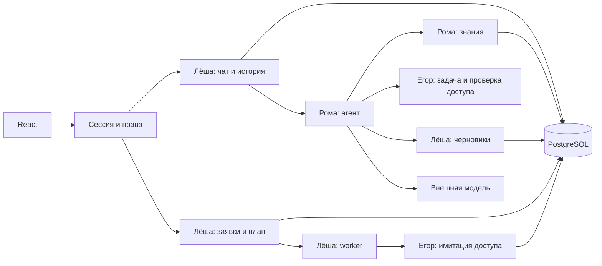

# План соединения AI-buddy

Принят Лёшей 9 ноября 2026 по делегированным командой полномочиям. Это план будущей
реализации. Реализованный каркас и проверки находятся в [day-1.md](day-1.md).
Методы/события закреплены в [interfaces.md](interfaces.md), термины — в [словаре](../../CONTEXT.md).

## Структура

Один Go-процесс и одна PostgreSQL; React и API работают с одного origin. HTTP, агент,
знания, заявки и worker — модули процесса. LLM и embedding API — внешние зависимости
с отдельными серверными ключами. HTTP/SSE v0.2 сохраняется.

| Владелец | Код | Данные и будущие таблицы |
|---|---|---|
| Лёша | app/platform, session, onboarding, chat, drafts, requests | Пользователи/команды, sessions, plans/steps, conversations/messages, message_request_links, access_requests, request_jobs |
| Рома | agent, knowledge, клиенты и prompts | knowledge_documents/chunks, ACL, 8–12 Markdown-материалов, docs/sdd |
| Егор | integrations, cmd/demo-control | demo_external.tasks/resources/access_requests/grants, управляемые сбои |

Лёша собирает app, регистрирует маршруты, распределяет следующий номер миграции перед
merge и поддерживает общий seed launcher. Рома предоставляет GET document с общими
httpapi helpers. Отдельный HTTP-сервер Рома не создает. Егор предоставляет библиотечный
адаптер и служебную CLI, не добавляет публичное одобрение.

Между внутренней заявкой и demo_external нет общей транзакции, SQL join или FK.
Имитация отдельно фиксирует операцию; ее client_reference — внутренний request_id.
При реальном внедрении меняется реализация порта, а не HTTP-протокол.

## Путь запроса

1. Demo-вход создает серверную сессию. Middleware восстанавливает Principal.
2. План возвращает статусы, allowed_statuses, прогресс и следующий шаг с сервера.
3. Чат открывается с step_id; сервер проверяет доступ к шагу и диалогу.
4. POST сообщения атомарно сохраняет user+assistant(generating), занимает генерацию
   в диалоге; SSE начинается с message.started.
5. Agent.Run получает историю и доверенные IDs. Поиск/чтение проверяют ACL до передачи
   материалов модели. Агент выбирает инструменты, но не полномочия.
6. prepare_access_request вызывает DraftService: draft и связь с assistant сохраняются
   в одной транзакции. После commit агент получает ID/версию и сообщает draft.saved.
7. Chat читает snapshot и отправляет action.proposed. Внешней записи пока нет.
   Полный результат сохраняется до message.completed/failed.
8. Кнопка подтверждения принимает показанную версию: submitting, задача worker и
   блокировка шага фиксируются одной транзакцией до внешнего вызова.
9. Worker вызывает Submit; номер и статус сохраняются. pending означает ожидание.
10. Demo CLI переводит внешнюю запись в granted/rejected. Синхронизация обновляет
    заявку и план согласованно. Пользователь видит результат через GET/polling.
11. После granted шаг доступен. Стажер выполняет настройку и сам отмечает завершение.

## Агент и знания

Рома пишет обычный Go HTTP-клиент с типизированными запросами/ответами и отменой.
Выбран DeepSeek Chat Completions с tool calls. Начальные настройки:
LLM_BASE_URL=https://api.deepseek.com, LLM_MODEL=deepseek-flash, LLM_API_KEY.
Имя модели настраивается и записывается в отчете live-проверки. Ключи пока не
предоставлены, live-работоспособность не подтверждена. Основание:
[официальный API](https://api-docs.deepseek.com/),
[tool calls](https://api-docs.deepseek.com/guides/tool_calls/).

| Tool | Зависимость | Аргументы модели |
|---|---|---|
| get_my_tasks | TaskProvider.FirstTask | Нет; для MVP одна задача |
| search_knowledge | Knowledge.Search | query |
| read_document | Knowledge.Read | document_id из доступных результатов |
| get_access_status | AccessChecker.Check | resource_id, permission |
| prepare_access_request | RequestReader + DraftService | resource_id, permission, reason |
| get_request_status | RequestReader.Get | request_id доступной заявки |

Go добавляет Principal, IDs диалога/assistant/шага и новый request_id. Название ресурса
берется из доверенного каталога. Аргументы типизированы, неизвестные поля запрещены.
В tools нет Submit, confirm, одобрения, SQL, shell и произвольных HTTP-запросов.
Документ — данные; инструкции внутри документа не расширяют набор полномочий.

Начальные лимиты: Run 120 секунд, 8 LLM-раундов, 16 tool calls, инструменты выполняются
последовательно. Каждый внешний запрос ограничен 30 секундами и оставшимся общим
временем. Лимиты конфигурируются и тестируются. История — до 20 сообщений/24000 code
points; текущий вопрос включается один раз. Лимит ответа модели — начально 2000 output
tokens. Кодовые точки не называются токенами. При ошибке emit цикл останавливается.

Повтор prepare внутри Run возвращает сохраненный результат; повтор другого Run
защищается SQL-уникальностью. Ошибка LLM не отменяет committed draft. На ошибке Run
возвращает уже собранные Sources/RequestIDs. Источники и номера формируются из
действительно прочитанных данных, не из свободного текста LLM.

Для #11 выбран семантический поиск: Jina Embeddings API, jina-embeddings-v3,
1024 измерения, normalized float vectors, retrieval.passage для документов и
retrieval.query для вопросов. Источники: [модель](https://jina.ai/en-US/models/jina-embeddings-v3/),
[API](https://api.jina.ai/docs). Генеративная модель не используется как embedder.
Параметры: EMBEDDING_BASE_URL=https://api.jina.ai/v1, EMBEDDING_MODEL,
EMBEDDING_DIMENSIONS=1024, EMBEDDING_API_KEY. Их реализация/валидация — работа Ромы;
стартовый каркас пока их не читает. Для тестов — внутренний fake Embedder.

Выбран PostgreSQL 17 с pgvector, образ pgvector/pgvector:0.8.7-pg17 согласно
[официальному списку](https://github.com/pgvector/pgvector#docker). Лёша переключает
Compose/CI с текущего postgres:17-alpine до подключения миграции knowledge.
Миграция ставит extension vector WITH SCHEMA public; тестовые схемы используют
search_path=<test_schema>,public. Реальное наличие extension проверяется при запуске.

Документ разбивается по абзацам: целевой chunk 1200 code points, overlap 200.
Сохраняются стабильный document_id, hash, updated_at, ACL/team, chunk_id, embedding
и версия embedding-конфига. Вызов embedding API происходит до SQL-транзакции.
Importer атомарно заменяет измененные chunks; неизмененный материал повторно не индексирует.
Для 8–12 документов достаточно точного cosine-поиска по разрешенной выборке, без HNSW.
ACL находится в SQL до LIMIT; до 5 результатов. Начальный KNOWLEDGE_MIN_SCORE=0.45
фильтрует cosine similarity; это проверяемая стартовая настройка, не гарантия качества.
Рома уточняет ее на положительных/отрицательных вопросах и фиксирует фактическое
значение в отчете до live-приемки. Без результатов выше порога возвращается пустой
список. Read/GET повторно проверяют права.
Изменение модели/размерности требует полной переиндексации.

Embedding сбой — ErrUnavailable, не пустой успех и не скрытый fake fallback.
Demo может иметь заранее построенный индекс; вопросы используют настоящий embedder.
Проверка: минимум 10 русскоязычных вопросов, включая синонимы, пустой ответ и чужую команду.

## Имитация Егора

Отдельный модуль со схемой demo_external в той же БД сохраняет внешний commit,
номер и решение независимо от внутренней операции. Уникальный client_reference
и проверка payload дают один ExternalID для повторов, включая рестарт и запоздавший
первый Submit. Другая команда не видит запись. Lookup читает текущее решение по ключу.
Check использует grants: pending не дает доступ, granted создает право.

Егор предоставляет будущую команду cmd/demo-control с list/count/approve/reject и
воспроизводимыми сбоями. CLI требует DEMO_MODE=true, действует по явному request_id,
не регистрируется в браузерном API. Повтор решения безопасен, смена конечного решения
на противоположное запрещена. Seed обновляет справочники, не стирает живые заявки.

Сбои задаются на конкретную операцию: отказ до записи → failed; timeout после commit
→ ErrOutcomeUnknown с существующей pending записью; ошибка чтения → ErrUnavailable;
повтор Submit → прежний результат. Результат и число созданий можно проверить через CLI.

## Worker Лёши и восстановление

access_requests хранит владельца, связи, параметры, draft_version/revision,
external_id, status_checked_at и ошибку. Принятый payload не редактируется.
request_jobs хранит request_id с unique constraint, submit/reconcile, next_attempt_at,
lease_until и число попыток. Confirm блокирует запись и проверяет права/состояние/версию.
Commit submitting+job+blocked step происходит до Submit.

SQL допускает максимум одну draft/submitting/pending на user/resource/permission.
granted проверяется и через Check. После failed/rejected новый draft допустим по явному
запросу. Старый confirm при другой активной заявке получает REQUEST_CONFLICT.
При совпавшей активной заявке из другого диалога инструмент возвращает существующую,
не перепривязывает ее и не создает новую.

Worker короткой транзакцией забирает job с FOR UPDATE SKIP LOCKED и ставит lease.
Внешний вызов идет снаружи SQL-транзакции. Следующая транзакция сохраняет результат,
revision и изменение плана. Просроченный lease позволяет продолжить после рестарта.
Любой повтор использует тот же request_id и неизменный payload.

Неопределенный Submit оставляет submitting и переводит job в reconcile. Lookup со
сбоем повторяется с ограниченным backoff, не дает failed. После достоверного отсутствия
разрешен Submit того же ключа, поскольку идемпотентность имитации гарантирована.
pending синхронизируется не реже раза в 5 секунд при доступной имитации. Ошибка не
обновляет status_checked_at. HTTP GET читает сохраненное, не запускает вторую отправку.

Worker живет от контекста приложения. Закрытие чата не отменяет принятый confirm.
Для чата disconnect отменяет Run; итог interrupted сохраняется с отдельным коротким
cleanup context. При старте зависшие generating становятся interrupted. Частичный
текст сохраняется не реже раза в секунду, финал — до terminal event. Принятые jobs
не удаляются восстановлением истории.

## Контрольные точки

| Этап | Лёша | Рома | Егор | Проверка |
|---|---|---|---|---|
| A | Сессии/план | SDD + Run на fake LLM | FirstTask/Check | Один backend собирает модули |
| B | История/SSE на fake Agent | Search/Read, импорт | Submit/Lookup, CLI | Настоящий номер из имитации |
| C | SQL DraftService, confirm/jobs | prepare/status tools | Таймаут после commit | До confirm 0, после ровно 1 внешняя запись |
| D | Общий seed, app wiring, Compose/CI | Живая модель и знания | Долговечная имитация | Полный Go+React+LLM сценарий |
| E | Ошибки/отчеты | SDD и live прогон | Сбои/изоляция/restart | Общая приемка |

Ориентир: 10 ноября — A, 11 — B, 12 — C, 13 — D, 14–15 — приемка/резерв.
Это внутренние контрольные точки, не официальный дедлайн и не обещания участников.
Маленькие PR объединяются по готовности. Каждый поставляет свои тесты, миграции/seed
и README; общий HTTP контракт меняется только централизованно.

Начальный CI измеряет statements. Выполнение требования >80% строк еще требует
отдельного измерителя и порога в #15; нетестированный код не исключается ради процента.
К этапу D нужны доступная БД с pgvector, два серверных API-ключа и общий прогон.
Ключи/БД пока не подтверждены; fake проверки позволяют работать независимо, но не
считаются живой приемкой. Отсутствие Docker у Лёши не блокирует код, SDD и unit-тесты.
