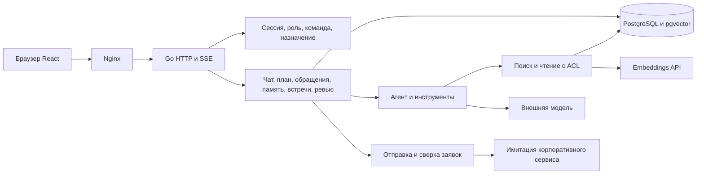

# Архитектура AI Buddy

Сверено с dev 3834f9b, 16 ноября 2026. Описание текущей структуры, а не план распределения работ.

## Компоненты

React/TypeScript обслуживается Nginx. Nginx передаёт API-запросы в Go.
Go — модульный монолит: HTTP/SSE, сессии, адаптация, чат, агент, знания,
обращения, память, встречи, подготовка к ревью и фоновые обработчики.
PostgreSQL с pgvector хранит продуктовые данные и поисковый индекс.
LLM и embeddings вызываются сервером; ключи не передаются браузеру.

Точка сборки — backend/internal/app; внутренние границы — backend/internal/ports;
публичные схемы — contracts/openapi.yaml. Внутренний Go-интерфейс не является MCP-сервером.

## Жизненный цикл запроса

1. Сервер восстанавливает пользователя из сессии и проверяет доступ.
2. Чат сохраняет сообщение; агент получает историю и серверный контекст.
3. Инструменты получают доступные документы и сведения; модель формирует ответ/предложение.
4. Сохранённые события и результаты отображаются через API/SSE.
5. Изменяющее действие проходит отдельную серверную проверку. Заявка требует явного подтверждения.
6. Отправка во внешнюю имитацию и сверка результата выполняются отдельно; pending не означает granted.

## Данные и доверие

Права определяются сервером, а не текстом пользователя, найденного документа или памяти.
Поиск и чтение ограничены доступом к источникам. Командные и HR-документы требуют соответствующей области доступа.
Содержание публичных источников не считается внутренним кадровым регламентом.
Личные заметки встречи и память имеют отдельные ограничения видимости.

Имитация корпоративных сервисов хранит своё состояние отдельно от продуктовых сущностей.
При замене адаптера нельзя предполагать общую транзакцию с внешним сервисом:
нужны идентификатор операции, обработка повторов и сверка неопределённого результата.

## Запуск и масштабирование

Compose выполняет миграции до API. Seed и импорт знаний запускаются отдельными командами.
Именованный том сохраняет БД. Текущая схема не доказывает готовность к горизонтальному
масштабированию: перед несколькими экземплярами нужны проверка блокировок, владения заданиями
и восстановления SSE/незавершённых операций. Сборка проверяет единственный активный экземпляр.
Подробнее: [интеграции](../integrations.md), [запуск](../../README.md), [проверки](../verification.md).
